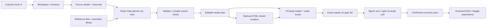

# Kiến trúc Talking Head Cutroom — quyết định theo setup local hiện tại

## Prompt đã tinh chỉnh

Audit checkout đang chạy; theo một recording từ import tới exact-master QC.
Đối chiếu tài liệu gốc về timeline, dựng theo frame và adapter model. Đề xuất
kiến trúc cho máy Windows riêng của từng khách, giữ footage và cache local trên
D trong setup này. Ưu tiên bỏ trùng lặp, làm rõ ranh giới, sửa lỗi đã đo được;
không thay renderer đang hoạt động chỉ vì vừa tìm thấy một framework khác.
Chứng minh bằng model worker mới, render thật và các ca bảo vệ chỉnh tay.

## Lựa chọn

Dùng **một ứng dụng local có các module rõ ràng**, với worker rời cho ASR/model/
render nặng. Giữ Python/FFmpeg làm đường xuất master; HyperFrames/Remotion là
renderer tùy chọn cho đồ họa, Recordly là nguồn capture, CapCut là bước hoàn thiện
tùy chọn. Kaggle chỉ thuộc vòng train thử nghiệm, không là dependency để người
mua mở project hoặc xuất video. Đây là đề xuất cho setup đã xác nhận chạy riêng
từng máy; không phải đánh giá hệ thống SaaS dùng chung cho hàng trăm người.

## Cơ sở nghiên cứu và tác động

- **Timeline và media tách nhau.** OTIO mô tả clip, timing, track, transition và
  media references; không nhúng video/audio. Kit nên giữ source hash, range và
  stable IDs trong plan, còn MP4 chỉ là kết quả dựng. Chưa cần thêm OTIO làm
  dependency runtime; chỉ thêm adapter trao đổi khi có nhu cầu mở NLE thật.
  [Tài liệu OpenTimelineIO](https://opentimelineio.readthedocs.io/en/latest/).
- **Hình là hàm của frame.** Remotion nêu rõ render phải cho cùng hình ở cùng
  frame và không phụ thuộc thứ tự gọi. Áp dụng cho cả ASS/native và HTML:
  không wall-clock, timer hoặc random không seed để quyết định animation.
  [Remotion: Flickering](https://www.remotion.dev/docs/flickering).
- **Retiming do compiler kiểm soát.** FFmpeg trim/atrim không tự đặt lại PTS;
  setpts/asetpts và concat phải dùng cùng source cuts cho hình và lời. Model
  đề xuất nội dung/đối tượng/bố cục, không là nguồn chân lý của actual contact.
  [FFmpeg filters](https://www.ffmpeg.org/ffmpeg-filters.html).
- **Load và active khác nhau.** PEFT tách load adapter khỏi bật/tắt adapter.
  Vì vậy base+RAG và tuned+RAG phải cùng retrieval/renderer; receipt ghi cả
  checkpoint đã nạp và adapter có active không. Không merge mất baseline.
  [Hugging Face PEFT integration](https://huggingface.co/docs/transformers/peft).
- **HTML renderer có hợp đồng riêng.** HyperFrames cung cấp timeline seekable,
  HTML editable và local CLI. Dùng nó cho scene, không thay receipt/QC master.
  Giữ runtime0.8.52 cho bridge cũ; skill/scene mới pin0.9.33, thử tương thích
  trước khi hợp nhất hai bản. [HyperFrames](https://github.com/heygen-com/hyperframes).

## Phản biện từ code và lần chạy thực

| Vấn đề có bằng chứng | Quyết định / trạng thái |
|---|---|
| `ArtifactStore.generate` giữ workspace lock trong cả inference/render | Đã đổi snapshot → làm việc ngoài khóa → kiểm revision trước commit. Tránh proposal cũ ghi đè chỉnh mới. State endpoint đã đo64ms trong lúc model đang chạy. |
| Chèn preview MP4 dễ biến preview có giọng thành nguồn hình lặp lại | Animation spec đi trực tiếp vào master render plan; voice và captions nằm trên bus/timeline gốc. Preview không trở thành nguồn sign-off. |
| Selector cũ và model spec là hai task khác nhau | Giữ định danh/registry riêng; không nhận trọng số selector hay video-diffusion làm spec adapter. Selector cũ không chứng minh khả năng tạo animation. |
| Model v1 chép chữ/anchor của ví dụ RAG vào tập Recordly | Chặn output. Sửa cách few-shot và đa dạng input; giữ checkpoint cũ, train candidate mới. Không hạ validator để cho qua chữ bịa. |
| Model v2 đề xuất hold dài hơn cảnh intro thật | Compiler chỉ được sửa hold theo frame budget, ghi before/after và raw validation error; không tự sửa lời, proof, source anchor hoặc bịa kết quả. Nếu còn dưới minimum thì yêu cầu dài cảnh/pickup. |
| Nhãn thử nghiệm gắn vào các reference families nhưng không tái dựng keyframe thật | Gọi đúng là **spec-conformance fixtures / rules distillation**. Không báo27 video đã train style; media reference thực đưa vào loss ở hai pilot spec này là0. Cần nhãn gắn timecode thật để kết luận fidelity. |
| Reference clip có chữ/người/logo đã bake | Thư viện giữ provenance, crop, source in/out và silent preview. Tách clip minh họa khỏi native template có thể thay chữ. Không lấy thành công trong reference làm thành công của tập mới. |

## Những gì chưa nên thêm

Không thêm microservices, Redis/Celery, Kubernetes, cloud storage bắt buộc, vector
DB hoặc hệ multi-agent tự động để giải bài toán một máy/khách. Các module hiện
tại đủ làm pipeline tuần tự có kiểm soát. Không cài cả469 repo trong awesome
catalog; dùng nó để tìm đúng năng lực thiếu và kiểm từng upstream.

Chưa chuyển toàn bộ workspace JSON sang database trong lượt này. Atomic replace
và session lock hiện có vẫn giữ tương thích. Nếu journal/corrections tăng tới mức
đo được việc đọc/lưu ảnh hưởng UI, cân nhắc SQLite và migration có test; không
thay chỉ vì số khách tổng thể lớn. SQLite có cơ chế atomic commit, nhưng dùng
database cũng không thay backup linked media.
[SQLite atomic commit](https://www.sqlite.org/atomiccommit.html).

## Phần còn phải chứng minh

- Ba flow đã có source/hash/phase timecodes và map sang pilot Recordly trong
  `docs/REFERENCE-FLOW-ANALYSIS.vi.md`. Đây là quan sát agent từ ASR/frame grids;
  chưa phải original keyframes hoặc nhãn human-confirmed.
- App → worker mới → checkpoint đúng → intro/demo → master đã chạy thật qua UI.
  Model vẫn cần compiler sửa hold/ROI; không dùng schema pass sau sửa để báo raw
  model đạt hết. Application failures được giữ để regression.
- So mù trên tập độc lập; đo first-pass acceptance và phút sửa/phút thành phẩm
  bằng dữ liệu người duyệt, không điền số giả. Adapter production vẫn tắt.
- Kiểm đầy đủ các style/cutout/photographic workflows trên Windows. Cài11 skill
  không có nghĩa11 renderer đã qua runtime hoặc editorial QC.
- Những thay đổi per-scene render hiện còn chạy đồng bộ; cần chuyển thêm ra
  ngoài khóa theo cùng cơ chế revision nếu đo thấy chặn UI. Không triển khai
  thêm job service chỉ để giải vấn đề đó.
