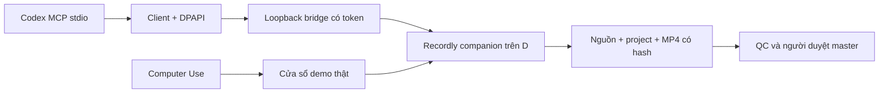

# Plugin Recordly cho Talking Head Cutroom

Bản local preview **0.1.1**, đã cài và bật bằng Codex CLI trên máy Windows hiện tại. Plugin có bảy MCP tools để mở companion, liệt kê nguồn, Start/Stop, lưu project và xuất MP4. Computer Use thực hiện click/phím trên cửa sổ demo trong lúc Recordly ghi.



Nguồn: [plugins/recordly-cutroom](../plugins/recordly-cutroom/README.md).
Báo cáo máy đọc được: [recordly-plugin-v001.json](evidence/recordly-plugin-v001.json).

## Cài và chạy lại

Từ checkout:

```powershell
codex plugin marketplace add 'D:\.codex\workspaces\talking-head-video-editing-skills\plugins' --json
codex plugin add recordly-cutroom@talking-head-cutroom-local --json
```

Từ `plugins/recordly-cutroom`:

```powershell
$env:TEMP='D:\recordly-test-temp'
$env:TMP=$env:TEMP
New-Item -ItemType Directory -Path $env:TEMP -Force
node --test tests/controller.test.cjs tests/http.test.cjs tests/mcp.test.cjs tests/prepare.test.cjs tests/client.test.cjs
node server/index.cjs
```

Lệnh cuối là server stdio, nhận JSON-RPC từng dòng. Mặc định chưa mở app, chưa quay. Dùng `recordly_open` rồi `recordly_sources`, lấy đúng ID + title cửa sổ vừa kiểm qua Computer Use. `recordly_start` dùng một `request_id` ổn định cho một yêu cầu; retry cùng ID không tạo take thứ hai. Muốn quay take mới phải dùng ID mới. Đọc `recordly_status` để biết trạng thái hiện tại thay vì suy từ response được replay.

Data mặc định ở `D:/.codex/workspaces/talking-head-support/recordly-plugin`; có thể đặt `CUTROOM_RECORDLY_HOME` sang một thư mục khác trên D trước khi khởi động server. Không thay token, xóa lock hay mở lại app khi kết quả thao tác còn chưa rõ. Bridge phải khớp fingerprint code của plugin; bản cũ đang chạy chặn upgrade/mutation thay vì mở app trùng.

## Kết quả thực tế ngày 13/11/2026

| Kiểm tra | Kết quả |
|---|---|
| Unit/protocol/security/recovery | 13 PASS, 0 FAIL, 0 SKIP |
| Ứng dụng thật | Recordly 1.4.0 companion riêng trên D |
| Capture thật | 19,26s, 1276×1210, không audio; mic/webcam/system audio tắt |
| Thao tác | Computer Use bấm nút fixture trong lúc Recordly quay; trạng thái kết quả hiện sau click |
| Project | Lưu và mở lại `.recordly`; lưu thêm version mới, giữ version đầu |
| Export đầy đủ | 1280×720, 30fps, SAR1:1, H.264 NVENC, 578 frame, 19,266667s |
| Export 5s | Cùng nguồn, cùng thiết lập, 150 frame |
| GPU | RTX 3070 Ti Laptop, 8192MiB, driver572.42 |
| Backend thực tế | Recordly native static-layout: scale CUDA + pad CPU + NVENC |
| Retry thật | Trả `replayed:true`, không đổi size/mtime MP4 |
| App gốc trên C | Hash main trước/sau trùng nhau |
| MCP của package đã cài | initialize, tools/list đủ7, gọi status thật trả STOPPED |
| Tool trong chat hiện tại | Chưa được discovery; cần làm mới lựa chọn plugin/chat, chưa chứng minh hot-reload |

Full export v008 có SHA256 `ba73b019cd3bfc0f170218f56ca1d29935818e75d413f6cfb0aaef042e70d027`. Nó trùng byte với v007 đã giải mã đủ578 frame bằng checker content/levels. Bản5s có SHA256 `573cf2db0972127e074cf4b1cafdabccfdc2da2739a8a6073ac47ca599bc2c6e`, đã giải mã150 frame. Cả hai không có technical FAIL. Các WARN không audio/không subtitle/giữ hình tĩnh được giải thích bởi mục đích B-roll im lặng và lượt test có thời gian chờ thao tác.

Đã xem trạng thái CUA trước/sau click và sáu frame decoded tại 01,633 /04,800 /07,967 /11,133 /14,300 /17,467. Nút còn khả dụng trước click; nút disabled và dòng “Test state changed” hiện ở các mẫu sau click. Không khẳng định đã kiểm sync click ở độ chính xác một frame, hay xem hết playback1× trên điện thoại. Clip cố ý im lặng nên không có kết luận về giọng/LUFS/master.

## Lỗi tìm thấy và đã xử lý

- Crop toàn nguồn không cần thiết nhưng kích hoạt nhánh GPU compositor: bỏ crop khi xuất nguyên khung.
- App restart mất quyền đọc media theo session: mở project đã lưu trước export.
- Native overlay_cuda trả file giải mã được nhưng ám xanh: giữ MP4 lỗi v003, companion dùng builder Kf có sẵn của Recordly. Source vẫn đúng màu. Không dùng compositor Windows bị kẹt hoặc wrapper NVIDIA mới không có trong build này. Guard từ chối backend chưa xác minh.
- Scale/pad kế thừa SAR hơi lệch: thêm `setsar=1`; v007/v008 đúng1:1. Giữ v006 để đối chiếu.
- Companion ghim SHA main đúng build đã thử và tắt kiểm tra cập nhật của bản chép. Không sửa app cài trên C, không phân phối runtime Recordly trong repo/ZIP.

## Giới hạn phát hành

Đây là adapter cho **đúng build unpacked Recordly1.4.0 hiện tại**, không cam kết chạy mọi bản Recordly1.4 hoặc2.x. Không có tool zoom/keyframe/trim/cursor compositing; capability `animated_zoom:false`. Cần kiểm thêm trước khi mở rộng hỗ trợ máy/build khác.

Trang fixture được ghi rõ là test, không phải bằng chứng một lượt export phần mềm thật hay B-roll cho vlog “5 repo”. Chưa quay lại đoạn FFmpeg đang thiếu trong vlog; chưa thay đổi/training model hoặc cấp READY cho master từ smoke này. Cảnh thật cần gắn đúng câu nói/beat, cho thấy target → action → result, rồi QC master sáu gate và người nghe/xem duyệt.

Giữ raw recordings, project và exports trên D. ZIP chỉ chứa source/config/skill/test/icon của plugin; không chứa runtime, media, token hay hồ sơ người dùng. Không upload plugin lên tài khoản hay public directory trong bước này.
