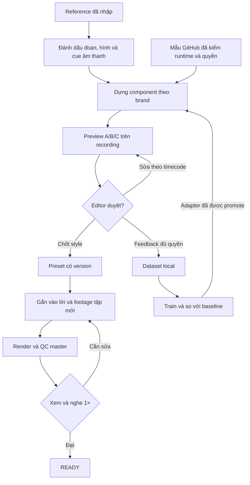

# Master prompt cho Codex — THC-KIT

## 0. Checkpoint hiện tại và phạm vi sử dụng

**Bản master cập nhật ngày 2026-11-16.** Consumer là coding agent phát triển THC-KIT. Đây là hợp đồng mục tiêu và điều kiện nghiệm thu; đọc một yêu cầu trong tài liệu không chứng minh tính năng đó đã được triển khai. Nếu nhiệm vụ hiện tại chỉ là cập nhật prompt, hoàn tất tài liệu/diff. Khi được yêu cầu triển khai, làm phần còn thiếu trong phạm vi user giao. Để dựng video thường ngày, dùng [prompt terminal](TERMINAL-EDITING-PROMPT.vi.md) và [hướng dẫn CLI](HEADLESS-AUTO-EDIT.vi.md).

- Mốc thiết kế lịch sử: `d1435e6d4a13c0e2385bcaad554165896cf26a90`. Các số dòng/count trong mục 2 và 11.3 thuộc mốc này; tra lại symbol/caller ở HEAD hiện tại trước khi sửa.
- Checkpoint source đã công bố: `2fe1ef23aa0b0c0dc5b5d24f51dd8813f09d9a9d`. HEAD có thể tiến sau checkpoint này. Ghi SHA thực tế, working tree và phạm vi thay đổi trước mỗi lượt.
- [Nghiệm thu đã chạy](HEADLESS-VALIDATION.vi.md): 392 tests, 379 passed và 13 skipped; batch ba tập **synthetic fixture có nhãn**, gồm hai demo đủ nguồn và một demo thiếu. UI đóng trong batch; stop sau tập 1 rồi fresh-process resume giữ export ID/hash; sửa nhạc riêng một câu tập 2 giữ voice, tập 1/3 và preset. Không biến những kết quả đó thành tuyên bố chất lượng trên recording khách hàng thật.

| Bề mặt | Checkpoint đã có | Phần cần tiếp tục triển khai hoặc chứng minh |
|---|---|---|
| CLI / UI chung dữ liệu | `auto-edit`, `status`, `resume`, `revise`, `library`; Workspace/render/QC và OS lease dùng chung; Files / Library / Outputs; mở A/B/C sau batch | Nghiệm thu workflow đầy đủ bằng recording thật; rà các thao tác folder intake, gán lại, tìm/lọc và copy-path theo mục 12.1 |
| Template / preset / reference | Import preset/template JSON defaults; native reference moments, scene trials, preset version/fork và scoped preference | Template nhiều lớp từ PDF/brand guide/frame AI; CLI tạo/chỉnh template end to end; một template cùng version sinh hai preset khác nhau và chuyển sang hai tập thật theo mục 11 |
| Mapping / best fit / render | Manifest → mapping đã xác nhận → basename duy nhất; native action/anchor/range/rights/runtime gates; draft có pickup; scene A/B/C và một whole master mỗi tập | Multi-take assembly; tự chọn preset khi được giao; ranking semantic/niche/neighbor context đầy đủ; xuất ba whole masters A/B/C theo yêu cầu. Không tự bịa flag cho các tính năng chưa nối |
| Model / học / cache | Auto-edit dùng rules + workspace-local scoped preference retrieval; model không bắt buộc. `--model` hiện ghi yêu cầu, chưa chứng minh một model selector thực sự load/gọi model | Chọn/load model hoặc adapter có receipt; local trainer resource policy, promote/rollback và đánh giá độc lập theo mục 8/11.4. Prefix hash khác provider cache hit |
| Runtime / readiness / QC | Native path đã render; thiếu demo chặn release; exact-master review vẫn bắt buộc | Readiness/invalidation UX đầy đủ còn THC-54; OpenShot và generator ngoài chưa đạt native-generation acceptance. Stop/resume sau tập hoàn tất không chứng minh khôi phục frame đang encode khi mất điện |

**Tất cả master của lượt fixture còn `NEEDS_REVIEW`, listening `UNVERIFIED`.** Không có LoRA mới, provider prompt-cache hit hay human approval được tạo trong checkpoint trên. Giữ nguyên mục tiêu dài hạn ở mục 1–12; báo `đã triển khai`, `đã quan sát`, `chưa kiểm` và `cần nguồn/phần cứng` riêng cho từng yêu cầu. Một regression pass không thay thế nghiệm thu sáng tạo hoặc nghe master.

Điểm nối bổ sung ở HEAD checkpoint: [headless service](../app/headless.py), [CLI parser](../app/headless_cli.py), [workspace lease](../app/workspace_session.py), [series/preset storage](../app/series_library.py), [scene trials và assembly](../app/series_studio.py), [Library service](../app/library_service.py). Tái dùng các điểm này cùng app/workspace.py và engine hiện có.

Chạy trong checkout của duytaday/THC-KIT. Ưu tiên mục 12 cho luồng CLI và auto-edit, dùng mục 11 để xây template cá nhân, đồng thời áp dụng hợp đồng render, quyền và QC trong mục 1–10. Trước khi triển khai, đọc checkpoint ở mục 0, xác minh HEAD và tái dùng phần đã có. Tiếp tục hoàn thiện các yêu cầu chưa đạt; không xây lại pipeline headless đã chạy được.

## 1. Kết quả người dùng phải làm được

Bạn là kỹ sư phụ trách trình dựng talking-head local-first. Hãy triển khai qua CLI dùng chung dịch vụ dựng với API hiện có. Creator trò chuyện với Codex hoặc Claude trong terminal. UI chủ yếu quản lý file, template, preset, component và xem bản xuất. Creator mở các reference đã nhập, chọn một vài đoạn đáng học, xem ba phương án dựng trên chính recording của mình, chỉnh một mẫu bằng tiếng Việt rồi khóa thành preset. Ở tập sau, creator chỉ cần chọn preset, nhập recording và script mới. Kit đề xuất animation, B-roll, SFX và transition đúng chỗ. Hook ba giây đầu, demo, caption và CTA phải gắn lại vào nội dung mới. Có thể dựng nhiều tập với cùng preset và tạo style thứ hai từ cùng một template.

Để tạo style mới từ reference, đầu vào là recording đại diện, script và reference. Khi dựng bằng preset/template đã có, không bắt creator nhập lại reference; dùng recording và script của tập mới, hoặc transcript local khi creator cho phép và ASR sẵn sàng. B-roll, screen recording, logo và stems là tùy chọn. Giữ giọng và ý nghĩa của người nói. Với cảnh cần chứng minh thao tác hoặc kết quả cụ thể, dùng hình quay thật của đúng đối tượng. Nếu thiếu, nêu chính xác đoạn cần quay bổ sung, giữ presenter hoặc illustration được ghi rõ và tiếp tục dựng các cảnh còn lại. Master chỉ được bàn giao khi các tuyên bố cần chứng minh đã được xử lý và QC của bản xuất đạt.

## 2. Bắt đầu từ code đang chạy

Ghi SHA và trạng thái working tree. Bảo toàn thay đổi của người dùng. Mốc thiết kế là d1435e6d4a13c0e2385bcaad554165896cf26a90. Nếu HEAD đã tiến, tìm entry point tương đương và kiểm lại hành vi trước khi sửa. Truy từ app/app.py và app/ui/app.js tới hàm xử lý, storage và test. Kiểm tra các đường dẫn sau:

| Điểm nối | Tận dụng |
|---|---|
| app/engine/references.py:6, app/reference_motion.py:8 | Phân tích shot, timecode nguồn và contact sheet. Có thể bỏ sót overlay xuất hiện trong một shot liên tục. |
| app/animation_library.py:8,29,55,87 | Native template, excerpt, review theo hash, gắn lại lời và anchor. Preview reference hiện bỏ audio. Giữ được dữ liệu cũ khi bổ sung kiểu mới. |
| app/motion_catalog.py:19,68,74, app/animation_runtime/{source-index,sources}.json | Bộ lọc điều kiện, ranking, chỉ mục repo, đăng ký render. Ở mốc thiết kế có 6 provider, 14 recipe và 420 mục source-index chưa xác minh render. |
| app/openings.py, app/ui/app.js:765, app/editing_styles.py:87 | UI mở đầu so hai treatment host/proof ở commit trên. Bridge trial-reels đã có đường render ba bản. Tái dùng phần phù hợp, nối A/B/C tới approval thực. |
| app/revisions.py:16,78,89, app/workspace.py | Feedback có revision, chống ghi lặp và chuyển style sang nhiều job. Mở rộng cho version của recipe, preset và override từng tập. |
| app/motion_hooks.py:10, app/qc_bridge.py:103, talking-head-qc/FINAL-QC-HOOKS.md | Kiểm tra trước render, QC file thật và xác nhận xem/nghe master. |
| app/motion_learning.py:134,145, app/motion_specs.py, app/train_motion.py, app/motion_worker.py, docs/MOTION-PLANNER-V009.vi.md | Retrieval, builder prompt, schema, trainer và local inference. Checkpoint V009 trong báo cáo chưa đạt để promote. Kiểm tra version thực tế trên máy. |

## 3. Hai quy trình dùng chung một thư viện

Thiết lập style theo series. Reference đã nhập → phát hiện đoạn đáng học → editor chỉnh in/out và cue → tái tạo thành recipe chỉnh được → thử A/B/C trên recording đại diện → editor sửa và duyệt → lưu template và preset có version.

Dựng mỗi tập. Recording + script + preset → transcript có timecode và EDL bản dựng nháp → chia theo ý nói → tìm component đủ điều kiện → gắn vào từ, hành động hoặc kết quả → nghe/xem preview A/B/C các đoạn quyết định → áp dụng bản đã chọn → render master → QC và duyệt. Chế độ tương tác cho creator chọn các đoạn còn mở. Chế độ auto-edit hoàn tất bản dựng tạm bằng preset và báo các quyết định ấy trong Outputs để creator có thể xem hoặc đổi sau khi batch kết thúc.

Học nền. Thu nhận phản hồi ngay sau mỗi lần chọn. Cập nhật thư viện sở thích trong đúng workspace và style để áp dụng được từ vòng tiếp theo. Huấn luyện adapter theo lô khi có đủ ví dụ độc lập được phép train. Dựng và chỉnh sửa vẫn hoạt động khi chưa có adapter hoặc máy thiếu GPU.


## 4. Hợp đồng dữ liệu và trạng thái

Giữ storage hiện tại nếu đáp ứng được. Bổ sung trường tương thích ngược và migration có thể chạy lại. Các tên dưới đây mô tả hợp đồng, không bắt buộc tạo sáu bảng hay sáu service.

| Đối tượng | Dữ liệu và ý nghĩa |
|---|---|
| Reference moment | Source hash, timebase, in/out, crop, đoạn nguồn có tiếng nếu được phép, keyframes quan sát, cue ứng viên, dấu hiệu nhận dạng, độ tin cậy, người sửa, các quyền sử dụng và phạm vi cá nhân. |
| Component template | Loại, mục đích biên tập, version, nguồn gốc, input slots, param/range, keyframes, easing, thời gian hold, vùng bảo vệ, cue SFX, mức gain tương đối, runtime, bằng chứng render và quyền. Template mô tả cách dựng. |
| Style preset | ID/version bất biến, creator/series, template version, thông số mặc định, trường khóa, khoảng được biến thiên, quy tắc chọn B-roll/SFX, asset brand được phép dùng chung. Một template tạo được nhiều preset. |
| Episode binding | Job/revision, beat, quote trong take thật, source PTS → frame timeline sau cắt, asset/hash, proof hoặc illustration, template/preset version và các override chỉ trong tập này. |
| Review decision | Ba preview ID/hash, parent revision, người duyệt, lựa chọn hoặc đoạn ghép, lý do, timecode, prompt chỉnh sửa nguyên văn, diff tham số và scope scene/preset. Tách lựa chọn tạm khỏi lần xác nhận lưu preset. |
| Training example | Context mà model thực sự thấy trước lúc chọn, approved target spec, cặp so sánh nếu có, version renderer, chứng cứ, family ID, quyền train, nguồn nhãn và split. Quản lý provenance cả khi tạo biến thể hay thu hồi một asset. |

Tách trạng thái theo từng chiều: đã lập chỉ mục, runtime render được trên máy này, editor duyệt thẩm mỹ, được phép dùng trong tập, được phép train, master được giao. Một checkbox không được đồng thời bật các trạng thái này. Với project cũ thiếu metadata, vẫn mở/dựng theo đường hiện có; quyền mới chỉ mở sau khi có dữ liệu phù hợp.

## 5. Từ video tham khảo đến component chỉnh được

1. Dùng hash và phiên bản bộ phân tích để tái dùng kết quả. Quét proxy trước; lấy frame độ phân giải cao và audio quanh vùng ứng viên khi cần. Phát hiện cả cut lẫn thay đổi cục bộ trong cùng shot, như badge xuất hiện, vùng màn hình phóng to, B-roll chuyển sang presenter và transient âm thanh. Gộp các sự kiện đồng thời trên nhiều track. Cho editor kéo lại in/out, đánh dấu bỏ hoặc thêm một đoạn bị bỏ sót.
2. Mỗi moment lưu cả phần quan sát và phần suy luận. Ví dụ: quan sát được card dịch ngang trong 6 frame; đường easing là ước lượng có thể sửa. Lưu PTS thật, chuyển sang timeline render theo schema hiện có, kiểm lại frame sau cắt. Có thể nghe khoảng reference trong player riêng khi quyền cho phép. Mix gốc chỉ là mix; giữ nhãn unknown khi chưa phân biệt chắc giọng, nhạc và hiệu ứng.
3. Tạo phiên bản theo brand của creator. Animation/motion dùng primitive và schema runtime hỗ trợ. B-roll tạo mô tả cảnh cần tìm, từ khóa, bố cục, nhịp cắt và điều kiện thay thế bằng footage cá nhân hoặc asset đủ quyền. Transition có hướng, điểm cắt, khoảng overlap, enter/settle và lựa chọn hard cut. SFX có điểm chạm, offset có chủ ý, gain/ducking và asset âm thanh hợp lệ. Nhạc có palette và luật ducking riêng. Caption, crop presenter và demo có vùng bảo vệ theo từng frame. Cho phép giữ presenter nếu hiệu ứng không giúp người xem hiểu rõ hơn.
4. Cắt excerpt phân tích theo quyền và hiển thị đúng source range. MP4 phẳng không cung cấp sẵn layer, alpha, easing gốc hoặc stem SFX gốc. Dựng lại thành native spec, hoặc dùng asset có quyền và quan hệ rõ với scene. Ghi riêng quyền phân tích, lưu excerpt, dùng bản gốc trong output, phân phối và train; thông tin chưa rõ chỉ vô hiệu hóa thao tác liên quan. Giữ media, embeddings, notes và adapters cá nhân ở workspace local. Public kit chỉ đóng gói các phần được phép phân phối.
5. Mở rộng source index GitHub có sẵn. Ghim URL, commit, path, blob, license/nguồn của code và media đi kèm. Chọn một ví dụ nhỏ cho mỗi family có ích. Khi được phép, lấy đúng phần cần dùng, ánh xạ thành tham số, render fixture local và ghi receipt về engine/version/output. Kho thiếu runtime vẫn tra cứu được, kèm lý do chưa dùng được và fallback local. Chỉ render qua integration đã cấu hình. Khi đủ quyền train, dùng cặp context → spec/params có render minh chứng. Không nạp nguyên một checkout làm bộ nhãn hay chạy mã model sinh ra.

## 6. Tìm và đặt component vào đúng lời nói

Phân đoạn theo chức năng: hook 0–3 giây, giải thích, demo, showcase/offer khi script có, CTA khi take có. Mỗi beat ghi điều người xem cần hiểu, lời nào đang nói, hình nào chứng minh được và lúc nào nên trả về presenter. Với screen recording, giữ đủ ba khoảnh khắc mục tiêu xuất hiện → thao tác thật → kết quả đủ lâu để đọc. Recordly là một nguồn capture có thể dùng khi sẵn sàng.

Lọc ứng viên trước khi xếp hạng theo quyền, scope creator, runtime trên máy, slot bắt buộc, aspect, thời lượng đủ đọc, proof phù hợp và các trường preset đã khóa. Sau đó xếp hạng theo ý nghĩa của beat, style đã duyệt, phản hồi user cùng phạm vi, mức dễ đọc và số lần vừa dùng. Kho style có thể chứa ví dụ tham khảo được phép phân tích; kho asset có thể chèn và kho dùng cho train phải lọc theo quyền tương ứng. Hiển thị “vì sao dùng”, “ghim”, “thay”, “bỏ hiệu ứng” và lý do loại ứng viên. Người dùng sửa thủ công luôn có thể giữ quyết định đó khi chạy lại.

## 7. Ba bản thật và vòng duyệt bằng prompt

- Chạy vòng đầu trên hook và ít nhất một demo có lời dẫn. Với mỗi vòng, tạo A/B/C có thể phát ở 1× với âm thanh; mặc định render đoạn ngắn, chung source, cut, thoại, caption và phần còn lại để so sánh. Có thể ghép các đoạn preview đã render với phần thân dùng chung cho trải nghiệm xem đầy đủ. Cho phép xuất ba MP4 đầy đủ nếu creator yêu cầu.
- A là lựa chọn đang dùng hoặc gần preset nhất. B/C là hai treatment khác nhau có lý do; chọn một trục đổi mỗi vòng, hoặc ghi rõ các thay đổi khi thử tổ hợp. Ví dụ so độ nhấn vùng nút bằng khung tĩnh, viền hiện dần, hoặc spotlight đi vào. Với vòng âm thanh, giữ hình và narration rồi thay đúng cue/mix. Nếu thiếu proof, tạo ba cách trình bày trung thực từ presenter/illustration khi khả thi. Nếu chỉ có hai phương án thực sự hợp lệ, chỉ rõ slot còn thiếu và lý do, cho editor nới một ràng buộc; không nhân đôi một preview để đủ số.
- Trong Outputs có thể mở trình so sánh gọn để đặt reference và A/B/C cạnh nhau; cho phép đồng bộ playhead, nghe lần lượt một mix, có solo để chẩn đoán và nghe lại full mix. Mỗi lượt cho chọn A/B/C, ghép hook B với demo A, từ chối cả ba hoặc nhập feedback theo timecode. Bản ghép được render lại trước khi duyệt. Khi các variant đổi nhiều yếu tố, không tự quy sở thích của user cho từng yếu tố riêng lẻ.
- Ví dụ feedback: “Giữ zoom của B. Cho viền xuất hiện đúng lúc con trỏ chạm nút. Giảm click 3 dB. Chỉ sửa demo này.” Parse thành patch có phạm vi, validate và cho xem diff/trước–sau; không ghi ngược vào preset khi scope là scene. Lượt sau A là bản vừa chọn; B/C thay đúng phần còn mở. Dừng khi creator duyệt hoặc từ chối, không lặp vô hạn vì điểm similarity.
- Khóa preset tạo version bất biến và cho phép fork. Style lock gồm primitive, palette, typography, độ mạnh zoom, mật độ transition, safe areas, cue policy và khoảng biến thiên được duyệt. Text, proof, từ neo, tọa độ thao tác và kết quả screen demo lấy lại từ từng tập. Dùng revision và idempotency key khi lưu. Hai cửa sổ cùng mở rev7: sau khi cửa sổ một lưu rev8, cửa sổ hai nhận conflict kèm thay đổi của mình và diff; chỉ rebase phần độc lập sau kiểm tra, giữ hai ý định khi trùng trường để người dùng chọn.

## 8. Model, RAG, huấn luyện và prompt cache

- Baseline hoạt động ngay là rule + retrieval local + renderer hiện có. Index theo creator, series/style, role và quyền. Lưu phản hồi cá nhân trong phạm vi editor chọn. Cải thiện ranking bằng lựa chọn A/B/C rõ ràng, cặp so sánh có cùng điều kiện, dấu hiệu reject-all và lý do. Tôn trọng abstain. Chỉ coi quyết định ở cấp scene là tín hiệu cho scene đó.
- Fine-tune generator tạo spec mới có thể render. X từ script/beat, dữ kiện thời điểm và inventory có quyền. Y là spec được editor duyệt, có anchor, motion và audio cue khai báo được kiểm. Dùng reconstruction từ reference đủ quyền đã duyệt, ví dụ repo được phép train đã render, và episode đã duyệt có consent. Với thành phẩm phẳng thiếu project gốc, ghi nhãn là reconstruction. Tách agent proposal khỏi human-approved target; tín hiệu reject-all không có positive target cho SFT. Nếu cần primitive vượt grammar, mở rộng renderer/schema, render fixture và duyệt trước khi train primitive đó.
- Giữ local adapter Qwen/PEFT tương thích backbone của checkout. Version hóa base + tokenizer + schema + dataset fingerprint + renderer + adapter. Job nền theo yêu cầu hoặc policy creator bật, khử trùng lặp, resumable, giới hạn tài nguyên và ưu tiên render. Hiển thị trạng thái khả năng máy; đo peak RAM/VRAM thực nếu chạy, không hứa train với 2 GB RAM. Có thể retrain sau nhiều vòng duyệt; một lần Save không tự bật training hoặc đổi model đang phục vụ. Có rollback về preset/rules hoặc adapter trước.
- Ở boundary gửi request, giữ prefix ổn định theo provider/model, phiên bản luật, tool/schema và locked style của series. Phần sau chứa script, retrieval biến thiên, assets, binding và review turn. Tránh đưa timestamp, UUID và thứ tự tool ngẫu nhiên vào prefix. Giữ checkpoint/prompt contract cũ có thể đọc lại. Đo diff byte ở request thực khi đổi script hoặc feedback, tách cache render và cache inference. Chỉ báo cache hit của provider khi có counter thực; backend local có thể chỉ báo prefix hash.

## 9. Tốc độ, kiểm thử và điều kiện phát hành

Cache riêng cho ingest/proxy, phân tích reference, ASR, shortlist, render scene, stem, mix và master. Khóa cache theo đúng dependency và version; render hoặc mix lại vùng chịu ảnh hưởng, gồm hai mép transition hay tail SFX/ducking. Nếu đổi cut làm dịch timeline, cập nhật bản đồ timecode và composite downstream. Lấy lại hash của master mới, chạy QC và yêu cầu lượt xem/nghe toàn bộ ở 1× cho lần xuất mới. Preview, cảm biến loudness hoặc việc đã chọn B không thể thay việc nghe master. Ghi elapsed, số lần decode/render, dung lượng cache và peak memory khi đo được.

| Dev replay bắt buộc | Quan sát để pass |
|---|---|
| Reference có overlay trong một shot liền và có tiếng click trong mix | Có ứng viên timecode hoặc editor đánh dấu lại được; mở được đoạn gốc có tiếng theo quyền. Không gán file stem riêng khi chỉ có mix. Trim tại mốc lẻ và VFR dùng đúng PTS. |
| Cùng một reference, hai style riêng và hai tập khác script | Hai preset cùng trỏ một template version với params khác nhau. Tập B giữ đúng field đã khóa, hook/CTA dùng lời mới, demo trỏ đúng source/hash mới. Không tái dùng lời, mặt, logo hoặc proof của reference khi chưa có quyền. |
| Chọn B → yêu cầu giảm riêng click 3 dB → chạy lại sau restart | Một thay đổi logic. Gain đúng trong stem/recipe, narration và hình ngoài vùng không đổi, ledger không nhân đôi, preset gốc không đổi. Ba preview thực phải khớp diff được báo; nếu mix/cue thay đổi, nghe lại full mix của đoạn. |
| Catalog có entry thiếu runtime hoặc asset chỉ được dùng phân tích | Hiện nguyên nhân, fallback đủ điều kiện hoặc presenter, giữ tham chiếu để nghiên cứu. Không apply asset gốc/train/promote trái scope. |
| Có kết quả trong reference nhưng recording mới thiếu cảnh thao tác | Đánh đúng beat cần pickup, dựng phần còn lại, không tạo proof giả. Với demo đủ evidence, marker neo frame thao tác, kết quả đọc được và caption không đè nút. |
| Re-export, retry và hai cửa sổ ghi đồng thời | Review cũ không cấp READY cho lần xuất mới. Retry không tạo thêm vote/version; stale write không ghi đè. |
| Đổi script, giữ series; sửa một cue; thu hồi quyền nguồn | Prefix phần ổn định giữ nguyên; chỉ cache phụ thuộc bị invalid. Thu hồi chặn retrieval/export/train tương ứng; vô hiệu hóa adapter bị ảnh hưởng cho đến khi có bản thay thế hợp lệ. |

Với anchor khai báo frame-locked có thể dùng mục tiêu dev lệch tối đa 1 frame trên timeline 30 fps; các cue cố ý vào sớm phải có offset riêng. Kiểm decode, vùng an toàn, watermark/lỗi bố cục, subtitle tiếng Việt, peak/clipping và mức thoại theo profile hiện có. Đánh giá cảm nhận ở 1× trên master thật: hook có tạo kỳ vọng rõ trong 3 giây, demo có thấy được hành động/kết quả, transition có giúp chuyển ý, SFX nghe được mà không lấn giọng, nhạc không che từ quan trọng và CTA có đúng take. Ghi người duyệt, master hash, export ID và timecode cần sửa.

Đánh giá model bằng replay đa lượt từ episode độc lập. Gom cùng recording, reference family, mọi crop/variant/revision, và derivative của template repo về cùng split. Cho personalization, đo thêm tập mới chưa thấy của cùng creator; nếu tuyên bố hiệu quả cho creator mới, giữ riêng cả creator. Dev retrieval chỉ được đọc dữ liệu được phép từ train và các quyết định quá khứ mà user thật đã cung cấp ở thời điểm đó. Không đọc sealed final, future correction hay đáp án vào prompt/RAG. So rules+RAG, model gốc cùng retrieval, và adapter ứng viên với cùng renderer/seeds/inputs. Đo riêng tính hợp lệ và khả năng render spec, tỷ lệ chọn mù theo episode, thời gian editor sửa, lỗi proof/lock/audio và chi phí laptop. Báo số episode/family, abstain/tie và độ bất định. Từng vòng chỉ đổi một giả thuyết, đặt ngân sách và tiêu chí promote trước, không promote khi mẫu thiếu hay có lỗi nghiêm trọng. Grader độc lập giữ final split cho lần release đã định.

## 10. Thứ tự thực thi và bàn giao

1. Milestone A — một luồng người dùng hoàn chỉnh. Qua CLI thật, khi UI đóng: nhập reference đã có, trim và nghe được moment → dựng lại ít nhất một hook và demo có B-roll/transition/SFX phù hợp → audition A/B/C → editor sửa bằng prompt → lưu preset → dùng lại trên recording thứ hai. Dùng renderer đã chạy được ngay trên máy; không tạo thêm phụ thuộc model cho bước này.
2. Milestone B — quản lý thư viện và chạy hàng loạt. Hoàn thiện lọc quyền/runtime, source index GitHub, ranking có lý do, chọn và fork nhiều style, concurrency và cache. Dùng ba mục Files, Library, Outputs như mục 12. Lựa chọn A/B/C hoặc lưu style qua CLI và qua thao tác ngắn ở trình xem khi cần. Có version, trạng thái và lý do block cạnh từng mục.
3. Milestone C — học có đo lường. Xuất corpus đủ điều kiện, replay baseline, triển khai adapter local tùy chọn và quy trình promote/rollback. Khi thiếu dữ liệu thật hoặc phần cứng, vẫn giao exporter, preflight và baseline chạy được; ghi đúng trạng thái việc train và số đo còn thiếu. Không giả người phê duyệt, không tuyên bố đã nghe nếu chưa có người nghe.
4. Thực thi chứ không dừng ở bản kế hoạch. Ưu tiên chạy xong Milestone A trước khi tối ưu B/C. Dùng fixture tự tạo cho smoke/regression và dữ liệu user đã cho phép cho dựng thật. Bàn giao diff, lệnh tái hiện trên laptop, đường dẫn A/B/C, version template/preset, chứng cứ rebind tập thứ hai, test đã chạy, cache hit/miss đã đo, trạng thái QC và blocker cụ thể cho phần chưa kiểm. Giữ final split niêm phong.

## 11. Prompt triển khai bổ sung — Tạo template từ reference, tài liệu và frame AI

Bạn là kỹ sư phụ trách tính năng Tạo template từ nguồn của tôi trong THC-KIT. Triển khai tính năng qua CLI và dịch vụ dựng hiện có. UI hiển thị các file, template, preset, component và preview đã tạo. Phần này cụ thể hóa Milestone A, dùng các quy tắc quyền, cache, revision, audio QC và đánh giá ở mục 4–9. Sản phẩm đầu tiên phải cho phép creator tạo một template chỉnh được, hai style preset và hai tập khác nội dung. Ưu tiên chạy được từ lúc chọn nguồn đến lúc phát MP4 trên laptop. Model được chọn trong ứng dụng có thể đề xuất cách dựng; sau khi lưu, renderer phải mở lại template đã duyệt ngay cả khi adapter tạo ra nó đã ngừng dùng.

### 11.1. Creator chỉ định muốn học điều gì từ từng nguồn

Cho CLI tham chiếu asset đã nhập bằng ID hoặc đường dẫn; Files cho xem và sửa vai trò khi cần. Cho chọn nhiều nguồn và chỉ định vai trò theo từng thuộc tính. Ví dụ một yêu cầu thực tế là “lấy nhịp hook từ 00:01–00:04 của video A, lấy bố cục demo từ video B, dùng chữ và màu theo trang 2 của brand guide, giữ giọng và màn hình của tôi”. Chuyển yêu cầu thành bảng có thể sửa trước khi dựng.

| Đầu vào | Kit lấy gì | Bằng chứng gắn với đề xuất |
|---|---|---|
| Video reference | Khoảng nghỉ, vào/ra hiệu ứng, lúc đổi từ presenter sang demo, thời gian giữ kết quả, cue nghe được | Asset, in/out theo PTS, vùng quan sát và trạng thái xác minh âm thanh |
| Tài liệu hoặc script | Điều bắt buộc về brand, điều được thay, thuật ngữ và mục tiêu của cảnh | Trang/đoạn và trích dẫn ngắn. Với PDF scan, đánh dấu chữ OCR chưa chắc để creator sửa |
| Recording, B-roll, ảnh, logo, screen capture | Tư liệu được phép xuất, chức năng của từng asset và vùng cần giữ | Source hash, vùng/timecode, quyền và vai trò proof hoặc illustration |
| Một hoặc hai frame do AI tạo | Bố cục mong muốn, vùng dành cho presenter, caption, nền và card ở đầu/cuối cảnh | Frame ID, vùng do creator xác nhận, nguồn tạo nếu biết và quyền sử dụng |
| Video đã được creator duyệt | Cách phối các component trên footage thực tế | Version bản dựng, spec cuối cùng nếu có và quyết định duyệt của creator |

Áp dụng lựa chọn rõ ràng theo thuộc tính và phạm vi. Ví dụ brand guide khóa caption màu xanh, còn reference dùng màu đỏ. Nếu creator chỉ chọn reference để học nhịp, dùng xanh ngay. Chỉ hỏi đúng một câu ở thuộc tính còn mâu thuẫn và có ảnh hưởng đến bản dựng. Hiển thị được “Vì sao kit chọn màu này?” kèm nguồn. Xử lý nội dung tài liệu như dữ liệu của dự án. Giữ tài liệu và media cá nhân trên máy theo thiết lập của creator.

### 11.2. Chuyển frame tĩnh thành template chỉnh được

1. Với một frame, đề xuất các vùng presenter, demo, headline, caption và background; cho creator sửa vùng bằng câu lệnh như “dời presenter sang góc phải”; nút đánh dấu vùng trên preview là tùy chọn. Với hai frame, cho xác nhận lớp nào tương ứng giữa đầu và cuối, lớp nào xuất hiện hoặc biến mất. Lưu hình chữ nhật tương đối, thứ tự lớp, vùng an toàn và quy tắc fit/crop.
2. Cho mỗi lớp động một hành vi renderer hỗ trợ, điểm bắt đầu, easing, điểm dừng và thời gian giữ. Hiển thị nguồn của mỗi quyết định: creator khai báo, quan sát từ video, hoặc model đề xuất. Một ảnh phẳng chỉ cung cấp điểm tham chiếu bố cục. Nếu cần nền mới hay lớp tách riêng, cung cấp asset thay thế hoặc bố cục bằng primitive rồi render thử.
3. Lưu ba lớp dữ liệu riêng: template định nghĩa slot, chuyển động và anchor tương đối; preset khóa thông số theo series; episode binding chứa text, media, vùng thao tác và timestamp của tập hiện tại. Khi lưu template, hiển thị trường nào có thể thay. Ảnh AI minh họa giao diện có thể dùng trong storyboard; beat tuyên bố đã bấm nút hoặc xuất file phải lấy bằng chứng từ screen capture đúng tập.
4. Kiểm bằng một thao tác nhìn thấy được: creator thay headline, đổi vị trí presenter và thay screen capture, rồi render lại. Caption tiếng Việt vẫn đọc được, card di chuyển độc lập, nút thật còn nhìn thấy. Khi xem lại một version đã khóa, hệ thống dùng spec đã lưu cùng version runtime và báo dependency nào cần khôi phục nếu máy thiếu.

### 11.3. Chọn hiệu ứng theo cảnh liền kề và theo lời nói

Kiểm tra app/motion_catalog.py:19 và các caller trước khi đổi input. Tại mốc d1435e6, hàm chỉ nhận thuộc tính của cảnh hiện tại trong danh sách cố định. Mở rộng tương thích ngược bằng context tùy chọn: treatment vừa dùng, trạng thái camera cuối cảnh trước, điểm nhấn sắp tới đã biết từ script và mức độ quan trọng của demo hiện tại. Giữ kết quả cũ cho caller không gửi context mới. Có thể chọn giữ presenter, hard cut hoặc giữ camera đứng yên.

Ví dụ, hook vừa punch-in và demo kế tiếp cần người xem đọc một nút nhỏ. Đưa mục tiêu vào khung trước khi click, giữ ổn định lúc thao tác và khi kết quả xuất hiện. Tránh chồng zoom mới lên chuyển động đã có sẵn trong footage Recordly. Neo SFX vào frame sự kiện hoặc offset được editor duyệt. Dùng sample có quyền, lưu gain riêng cho cue, kiểm độ rõ của giọng trên full mix. Mỗi phương án có một dòng giải thích cụ thể, ví dụ “giữ khung tĩnh để đọc chữ Xuất video”.

### 11.4. Dùng RAG ngay và fine-tune khi có tín hiệu học

- Tạo đường chạy baseline từ luật, retrieval cục bộ và renderer. Tách dữ kiện thay đổi như logo, thuật ngữ, quyền dùng asset khỏi sở thích có thể học như lúc chuyển sang demo và cách phối zoom với SFX. Đổi logo phải có hiệu lực ở preset version mới mà không cần train lại.
- Nối đường model sinh template từ script/beat + style đang khóa + danh sách asset đủ quyền sang spec có slot, keyframe và cue hợp lệ. Kiểm schema và render preview trước khi đề nghị duyệt. Nếu model chọn primitive thiếu runtime, ghi lý do và thử treatment local phù hợp. Kiểm tra backbone, tokenizer và grammar của checkout trước khi gắn LoRA.
- Lưu input tại đúng thời điểm lựa chọn, spec sau khi sửa, hash preview và bản ghi approval. Với feedback “giữ B, click nhỏ hơn 3 dB trong demo này”, chỉ lưu sở thích dài hạn khi creator chọn áp dụng cho series. Có thể dùng cặp ưu tiên đúng phạm vi cho ranking. Dữ liệu SFT cần target chỉnh được, đủ quyền train và đã xác nhận. Feedback mô phỏng mang nhãn fixture và tách khỏi dữ liệu cá nhân.
- So adapter với baseline trên cùng script, retrieval, renderer và ngân sách. Đếm spec render được, lỗi giữ style, phút sửa và lựa chọn mù trên tập độc lập. Tách đánh giá khả năng hiểu cảnh khỏi chất lượng render. Chỉ bật adapter sau khi đạt tiêu chí phát hành đã ghi trước. Nếu máy thiếu bộ nhớ hoặc chưa có đủ ví dụ độc lập, giao tính năng tạo template bằng baseline và báo rõ trạng thái trainer. Giữ final split niêm phong.

### 11.5. Kịch bản nghiệm thu qua CLI và bản xuất thật

| Tình huống | Chứng cứ Codex cần bàn giao |
|---|---|
| Tập 1 — Cách xuất video. Dùng hai reference có vai trò khác nhau, một brand guide, frame AI và recording có thao tác thật. | Ba preview A/B/C có tiếng của hook 0–3 giây và đoạn demo. Cùng take và cùng thông tin cần truyền đạt. Creator chọn hook B, demo A; bản ghép phát lại được trước khi lưu. Khi chỉ có một frame AI, vẫn tạo được bố cục có slot chỉnh được. |
| Một template, hai style. Lưu Tutorial Calm và Product Launch dựa trên cùng template. | Hai preset trỏ đến cùng template version, có diff cụ thể về hold, motion hoặc cue. Phát hai preview trên cùng footage để thấy/nghe được khác biệt. Sửa preset thứ hai không làm thay đổi tập đã khóa với preset thứ nhất. |
| Tập 2 — Cách thêm phụ đề. Đổi script, recording và vị trí nút. Dùng lại preset tập 1. | Hook nói đúng vấn đề mới, vùng zoom trỏ đúng nút mới, CTA khớp take mới. Kiểm persisted bindings và khung hình đã render để phát hiện text, timecode hoặc proof của tập 1 dùng nhầm. |
| Dữ kiện xấu có chủ đích. Frame AI có hộp thoại thành công nhưng capture thật thiếu kết quả. Cảnh trước đã zoom. | Gắn pickup cho đúng beat và cho dựng tiếp phần khác. Đề xuất giữ khung hoặc lý do hợp lý nếu vẫn zoom. Khi bổ sung capture, bind lại proof và kiểm vùng nút trên output. |
| Một chỉnh sửa bằng prompt. “Giữ camera của B, giảm riêng click 3 dB ở đoạn demo.” | Cho thấy diff có scope, gain trước/sau, hình và narration ngoài thay đổi vẫn đúng. Chạy lại sau restart không ghi thêm vote. Nghe lại preview; lần xuất master mới vẫn cần người xem và nghe đủ ở 1×. |

Bàn giao: ưu tiên hoàn tất luồng headless qua CLI với baseline, sau đó nối adapter tùy chọn. Cung cấp diff, lệnh chạy trên laptop, đường dẫn preview, template và hai preset, bản so sánh binding của hai tập, thời gian chạy và số lần editor phải sửa nếu thực sự đo được. Phân biệt kết quả tự động, xác nhận của người thật và phần chờ media hoặc phần cứng. Khi dùng fixture chỉ kết luận khả năng vận hành. Chất lượng sáng tạo cần được đánh giá trên hai tập thật.

## 12. Ưu tiên triển khai — Chat qua CLI, UI quản lý file, auto-edit toàn bộ batch

Trải nghiệm đích. Creator mở Codex CLI hoặc Claude Code trong project và gõ: “Dựng tất cả recording trong thư mục tuần này theo preset Tutorial Calm. Chọn demo, B-roll, ảnh và logo hợp với từng câu. Xuất mỗi tập một MP4; cho tôi xem A/B/C của hook và báo tập nào thiếu footage.” Một yêu cầu phải đưa tất cả tập đủ dữ liệu đến bản xuất xem được. Creator có thể đóng UI trong toàn bộ quá trình.

### 12.1. UI gọn với ba mục

| Mục | Việc creator cần làm |
|---|---|
| Files | Thêm hoặc kéo thả thư mục, xem thumbnail/tên, loại, episode và vai trò. Cho gán lại một script/footage đang ghép nhầm. File có thể nằm nguyên chỗ cũ; dùng cùng ID nếu import lại. |
| Library | Xem, tìm, thêm và chọn template, preset, component. Lọc theo demo footage, B-roll, ảnh, animation, transition, SFX, nhạc, logo, PDF hoặc frame AI. Mỗi mục có một preview, version và trạng thái dùng được trên máy. Thêm component vào workspace, preset hoặc một tập theo phạm vi creator chọn. |
| Outputs | Một hàng cho mỗi tập, gồm bản mới nhất, trạng thái, lý do cần xem và nút mở file/thư mục. Bấm vào hàng mới hiện các version, preview A/B/C và ghi chú theo timecode. Cho copy đường dẫn hoặc lệnh chỉnh lại tập đó. |

Mặc định mở đúng workspace gần nhất. Một nút chính phù hợp ở từng mục là đủ. Giữ dashboard chat, timeline nhiều track và màn hình chỉnh model ngoài phạm vi phiên bản này. Nếu repo đã có công cụ nâng cao thì bảo toàn đường truy cập cũ. Cả CLI và UI đọc cùng một bản ghi về nguồn, revision, preset và output; đổi tên/gán lại từ phía này phải hiện đúng phía kia.

### 12.2. Hợp đồng giữa AI CLI và engine dựng

Bắt đầu từ app/cli.py: mốc thiết kế có inventory, analyze, render, qc; checkpoint mục 0 đã bổ sung auto-edit, status, resume, revise, library qua app/headless_cli.py và app/headless.py. Dùng lại engine, workspace, hàm ghép script app/assignments.py và QC thay vì tạo thêm một pipeline riêng. Tách việc hiểu câu tiếng Việt/Anh khỏi thao tác xác định được: AI dịch ý định thành request có schema; engine kiểm tra và chạy request đó. Các CLI hỗ trợ cùng command contract. Nếu repo dùng cách đặt tên khác, giữ entry point tương thích và ghi lệnh đã chạy được.

Các lệnh dưới đây đã có tại checkpoint mục 0; kiểm tra help và chạy lại với nguồn của project khi thay code. Đây là command contract nền, không phải bằng chứng rằng mọi yêu cầu mở rộng trong tài liệu đã hoàn tất:

```powershell
python app/cli.py auto-edit --workspace "./Kenh Ali" --inputs "./recordings" --scripts "./scripts" --components "./components" --preset "./examples/headless/tutorial-calm.json" --out "./outputs" --json
python app/cli.py status --workspace "./Kenh Ali" --run RUN_ID --json
python app/cli.py resume --workspace "./Kenh Ali" --run RUN_ID --json
```

Hỗ trợ nhận --template thay --preset để chạy bằng mặc định template. Với --plan-only, liệt kê tập, mapping, style và issue dự kiến; chạy bình thường tiến thẳng tới render. Phản hồi máy đọc được gồm run ID bền vững, episode ID, revision, trạng thái, output path, preview paths, model/adapter thực dùng và hành động tiếp theo nếu có. Ghi log tiến độ riêng để stdout JSON parse được. Phân biệt render thành công đang chờ xem với lỗi xử lý. Trong ví dụ, đường dẫn tương đối trên CLI tính từ thư mục gọi lệnh; đường dẫn trong file manifest tính từ thư mục chứa manifest. Để AI tra cứu và sửa tiếp từ terminal bằng episode ID, ví dụ “chỉ giảm nhạc tập 03 khi tôi nói giá”; ghi vào revision mới.

### 12.3. Auto-edit phải dựng trọn các recording

1. Phân vai và ghép input. Phân biệt footage người nói cần dựng với reference, screen recording, B-roll, logo, ảnh, PDF và beat sheet. Ưu tiên manifest do creator khai, rồi mapping đã xác nhận, rồi tên khớp duy nhất. Một tập có thể gồm nhiều take, một thư mục có thể chứa nhiều tập. Nếu creator chỉ có recording và đã cho phép dựng theo lời thực, dùng transcript của recording làm kịch bản nguồn, ghi rõ nguồn transcript trong kết quả. Mapping mơ hồ thì gom câu hỏi vào một danh sách theo tập và tiếp tục các tập khác. Inputs được bảo toàn; output, cache và thư mục chứa bản xuất cũ phải được loại khỏi lần quét nguồn tiếp theo.
2. Chọn hợp với recording. Dùng transcript thật, ngôn ngữ, frame/aspect, beat, từ neo, chất lượng nguồn, độ dài có thể đọc và cảnh liền kề. Preset được chỉ định là ràng buộc. Nếu creator giao “tự chọn style”, xếp hạng các preset đủ điều kiện và ghi vì sao chọn. Xếp hạng tiếp từng component sau khi lọc quyền, runtime và dữ kiện. Với mỗi cảnh, ghi asset nào đã chọn, vùng/timecode nào, lý do và phương án dự phòng. PDF có thể cung cấp kiến thức hoặc một trang minh họa đủ quyền; chỉ đưa trang lên hình khi nó giúp giải thích lời nói. Một recording không cần dùng đủ mọi loại component.
3. Chọn model đúng phạm vi. Cho creator khoanh vùng adapter/model local hoặc provider đã bật và ngân sách máy. Ưu tiên khả năng tạo spec hợp lệ, kết quả dev trên cùng niche và chi phí dự kiến. Quyết định model tách biệt với quyết định chọn preset và footage. Thiếu adapter thì rules + local RAG vẫn dựng được; ghi đúng phương án dùng thực tế. Chỉ gửi nội dung tới provider ngoài theo cấu hình chia sẻ của workspace. Cùng input, version, seed và quyết định đã lưu thì phải replay được kế hoạch dựng.
4. Dựng và xuất. Cắt take, caption, crop presenter, gắn demo/B-roll/ảnh, kế đến là animation, logo, transition, SFX và music. Tạo A/B/C quanh các đoạn cần lựa chọn theo mục 7; auto-edit chọn một bản hợp preset làm bản dựng tạm và xuất luôn master đầy đủ. Khi creator yêu cầu “xuất cả ba bản đầy đủ”, tạo đủ ba MP4 cho mỗi tập đủ điều kiện. Lựa chọn tự động ghi là auto, tách khỏi phê duyệt của người thật và nhãn train. Thiếu một demo thì xuất được draft trung thực nếu khả thi, đánh dấu beat cần pickup. Nếu không có nguồn người nói đọc được, báo blocker cụ thể cho tập đó.
5. Hoàn tất và tiếp tục. Trả một bảng tổng kết ngay trên CLI với mỗi tập, revision, đường dẫn master và action cần làm. QC kỹ thuật chạy trên chính file xuất. Tập đang chờ nghe master ghi NEEDS_REVIEW; dùng READY theo gate hiện hữu sau khi xác nhận đủ. Cho dừng/tiếp tục batch, giữ tập đã hoàn tất. Khi thêm một footage còn thiếu hoặc sửa một cue, tự xác định tập/cảnh phụ thuộc rồi render version mới. Không ghi đè recording hay master trước đó.

### 12.4. Kiểm thử chấp nhận trước khi bàn giao

- Headless, nhiều tập. Từ CLI, trên bộ dev có hai tập đủ nguồn và một tập thiếu demo, chạy một lệnh với UI đóng. Phải tìm thấy hai master đầy đủ và master draft trung thực của tập thiếu demo nếu phần người nói dùng được. Mỗi hàng có đúng script, preset/version, output path và lý do cần xem. Các MP4 giải mã và phát được.
- Best fit theo nội dung. Đưa hai screen capture có tên gần giống nhưng thao tác khác nhau. Tập nói “xuất video” và tập nói “thêm phụ đề” phải lấy đúng capture/ROI của mình. Nếu thiếu căn cứ để phân biệt, engine phải hiện lý do và phương án fallback. Đối chiếu frame kết quả với nguồn, không chỉ so tên file.
- Auto và human có lịch sử riêng. Chạy batch đến lúc xuất xong khi chưa có người duyệt. Đổi một lựa chọn ở tập 2 bằng CLI; tập 1 và preset khóa vẫn mở đúng version cũ. Xem lại trạng thái từ UI. Sự kiện auto không làm tăng số nhãn đã được người thật duyệt.
- Chạy lại an toàn. Ngắt sau tập 1, resume từ terminal mới. Không tạo thêm một kết quả logic cho tập 1, không nhặt output vào input. Chạy thêm trường hợp đường dẫn có dấu và khoảng trắng, hai file trùng tên ở hai thư mục, template không có LoRA và output nằm dưới cây input.
- Bàn giao thực tế. Chạy lệnh từ đúng thư mục ghi trong README rồi đính kèm lệnh đã kiểm, manifest đã bỏ thông tin riêng, tổng kết batch, đường dẫn output, thời gian xử lý và điều còn chờ người nghe. Giữ chat tự nhiên trong terminal, còn UI chỉ cần chứng minh ba thao tác: thêm file, chọn component/preset và mở bản xuất.

### 12.5. Thay demo còn thiếu và vô hiệu hóa đúng phạm vi

Hợp đồng đã được creator xác nhận: tập thiếu demo vẫn có thể xuất draft từ lời dẫn, caption và những cảnh đủ nguồn. Tại câu thiếu proof, giữ presenter hoặc minh họa có nhãn, ghi chính xác quote/timecode cần quay. `NEEDS_PICKUP` của nội dung độc lập với runtime readiness và `NEEDS_REVIEW` của master. Chỉ có preview đẹp hoặc runtime render được không bỏ qua gate thiếu thao tác/kết quả.

Khi creator bổ sung recording demo:

1. **Gắn lại nguồn mới.** Ghi source hash, quyền, episode/scene revision và source PTS mới. Xác định nút, frame bấm thật, thời điểm kết quả và khoảng giữ đủ đọc trên chính clip đó. Không giữ tọa độ/timecode của demo cũ hoặc mượn kết quả từ reference/frame AI.
2. **Dựng lại dependency bị ảnh hưởng.** Cập nhật crop/zoom, con trỏ/highlight, SFX click, chuyển vào/ra demo và vùng caption. Dùng một camera controller; giữ chuyển động/click đã baked nếu phù hợp. Nếu cut/thời lượng thay đổi, tính lại source → master clock, cue và composite phía sau cùng tail transition/SFX/ducking. Invalidate preview/scene evidence phụ thuộc nguồn hoặc revision cũ; tái dùng phần còn khớp dependency thay vì reuse mù quáng. Giữ immutable preset và output các tập không liên quan; nếu một dependency dùng chung thực sự đổi, ghi rõ phạm vi ảnh hưởng.
3. **Xuất version mới và duyệt đúng master.** Giữ MP4 cũ, tạo export ID/hash mới, chạy QC trên file mới. Người duyệt xem và nghe toàn bộ ở 1×: thao tác khớp lời, nút/kết quả đọc được, caption không che, click cân với giọng và các mép cảnh không lỗi. Review gắn với master cũ không cấp READY cho bản mới. Chỉ READY khi hết defect/pickup bắt buộc và bản mới đạt các gate cùng xác nhận người duyệt thật.

Nghiệm thu bổ sung: bắt đầu từ draft thiếu Save → thêm capture đủ target/action/result → resume hoặc revise theo contract đã hỗ trợ → xuất version mới của đúng tập. So hash/export ID tập khác và preset trước/sau; kiểm source pixels, frame cue và hai mép cắt. Chưa có media hoặc chưa có người nghe thì giữ trạng thái chờ tương ứng, không điền approval thay người dùng.

### 12.6. Tiếp tục từ checkpoint và bàn giao từng phần

- Kiểm tra `python app/cli.py auto-edit --help`, `revise --help` và `status` của run đang có trước khi đặt thêm command/flag. Resume run cũ khi đang tiếp tục cùng batch. Lựa chọn scene hiện có thể gửi bằng patch có `round`/`choice`; scoped music dùng một câu timed duy nhất. Mở rộng request schema có version khi cần operation mới, đồng bộ CLI/API/UI và báo khả năng chưa hỗ trợ rõ ràng.
- Với lỗi/gap thuộc mục 12, sửa trên cùng service, chạy regression liên quan và replay có kiểm chứng trước. Sau khi luồng headless đạt phạm vi đang giao, làm mục 11 trên nguồn được phép: template chỉnh được → hai preset cùng template version → hai tập khác nội dung. Không thêm model dependency để chặn baseline đang hoạt động.
- Bàn giao bảng requirement → source change → check thực chạy → artifact → trạng thái còn lại. Ghi commands/CWD, manifest đã bỏ thông tin riêng, preset/component version thực dùng và lý do chọn/loại, paths/hash master và A/B/C, QC, pickup, thời gian/chi phí/memory chỉ khi đo thực. Tách kết quả đã quan sát khỏi kế hoạch hoặc test chưa chạy.
